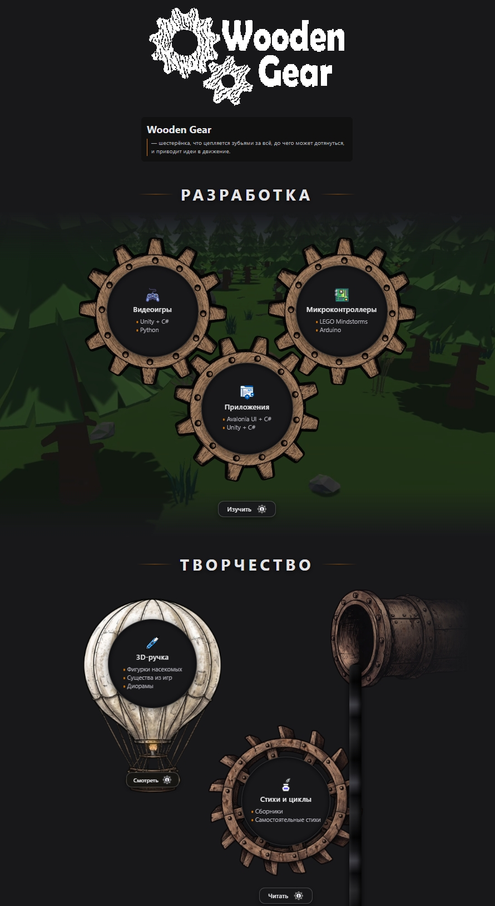
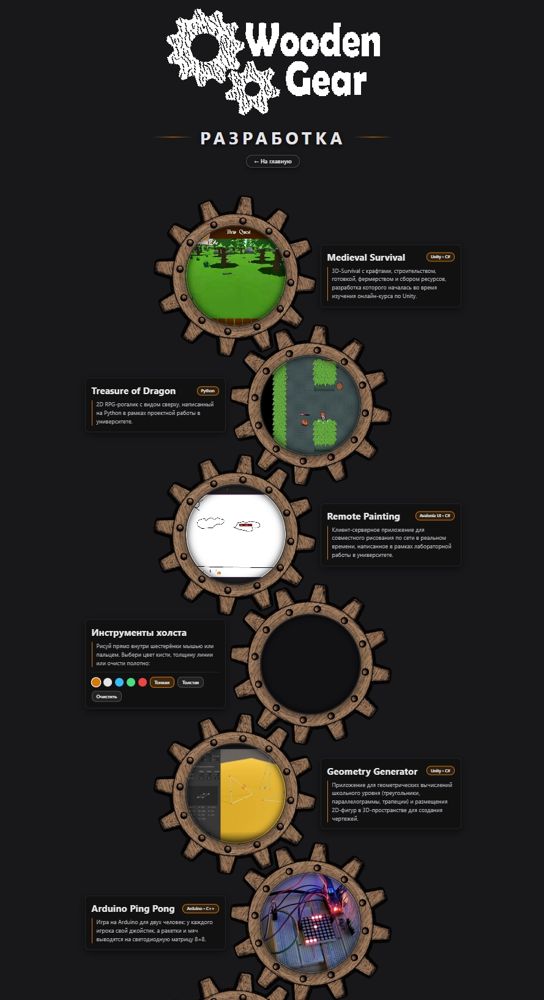
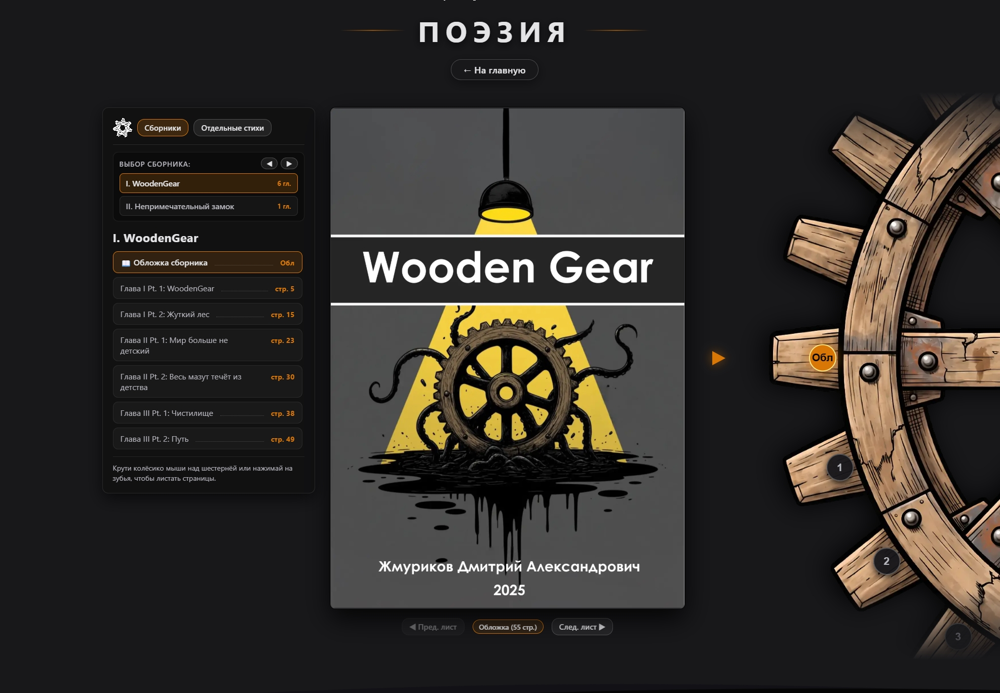
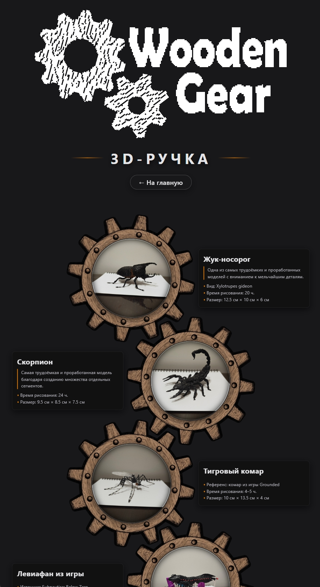
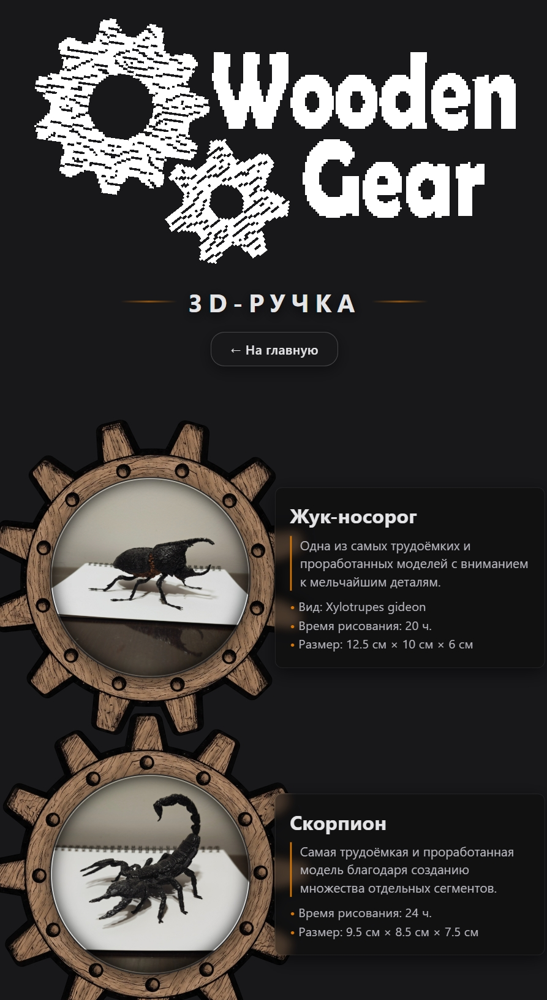

<div align="center">

# ⚙️ WoodenGear — Персональный интерактивный сайт-портфолио

**«Шестерёнка, что цепляется зубьями за всё, до чего может дотянуться, и приводит идеи в движение»**

[](https://woodengear.ru)
[](#)
[](#)
[](#)

</div>

---

## 📖 О проекте

**WoodenGear** ([woodengear.ru](https://woodengear.ru)) — авторский статический сайт-портфолио, объединяющий разработку ПО, микроконтроллеры, поэзию и моделирование 3D-ручкой в едином индустриальном дарк-крафт стиле.

Весь интерфейс построен вокруг **живой кинематики**: зубчатые передачи, вращающееся под потоком вязкого мазута водяное колесо, парящий воздушный шар с реактивной горелкой и гигантский маховик для перелистывания страниц книг. Проект написан с нуля на чистом **HTML5 / CSS3 / Vanilla JavaScript** без использования сторонних библиотек и тяжёлых фреймворков.

---

## 🖼️ Скриншоты интерфейса

### Главная страница (`index.html`)
> Вращающийся кластер шестерёнок раздела «Разработка», парящий воздушный шар, мазутный трубопровод, водяное колесо и бесшовные двухслойные волны океана мазута.

<p align="center">
  
</p>

### Страница разработки и интерактивных модулей (`dev.html`)
> Вертикальная кинематическая цепь из 9 шестерёнок в шахматном зацеплении ($60^\circ$) со встроенными приложениями, аппаратной симуляцией и мини-играми на HTML5 `<canvas>`.

<p align="center">
  
</p>

### Читалка поэзии и сборников (`poetry.html`)
> Механическая картотека оглавления слева, лист произведения формата A4 по центру и гигантская 20-зубая шестерня-маховик справа с номерами страниц на зубьях.

<p align="center">
  
</p>

### Галерея работ 3D-ручкой (`3D_painting.html`) и мобильная адаптация
> На смартфонах (`<= 820px`) шахматные цепи перестраиваются в строгий вертикальный ряд, а маховик чтения утапливается в чёрные волны футера.

<p align="center">
  
  
</p>

---

## ⚙️ Интерактивные механики и модули

1. **Кинематический движок шестерёнок и мазута:**
   * Единый цикл `requestAnimationFrame` с расчётом инерции и вязкости (`viscosity`).
   * Плавное ускорение шестерёнок при наведении на кнопки действий и при скролле страницы.
   * Реактивное свечение горелки и подъём купола воздушного шара при наведении, расширение потока мазута из трубы и разгон водяного колеса.

2. **Интерактивный холст (`Remote Painting`):**
   * Встроенный в шестерёнку графический `<canvas>` с поддержкой мыши и тач-экрана, палитрой цветов и сменой толщины кисти.

3. **Эмулятор светодиодной матрицы 8×8 (`Arduino Ping Pong`):**
   * Полноценная аркада в стиле аппаратной матрицы `MAX7219` (платформы по 3 светодиода, ручная подача, нелинейный отскок мяча и адаптивный ИИ-соперник с элементом случайности).

4. **Инженерная головоломка «Редуктор WoodenGear» (6 уровней):**
   * Честный расчёт графа зубчатых зацеплений (малые шестерни на 8 зубьев, средние на 12, большие на 16).
   * Проверка направления вращения, повышающей передачи (`2x` Турбо-вал), лимита деталей на складе и обнаружение механического клина при замыкании конфликтующих контуров.

5. **Механическая читалка книг (`poetry.html`):**
   * Поддержка многостраничных сборников с титульной обложкой (`Обл`), оглавлением по главам и отдельных стихотворений.
   * Бесконечное кольцо нумерации на 20-зубой шестерне (поддержка книг любого объёма за счёт динамического пересчёта углов в видимой дуге).
   * Защита от гонки сетевых запросов (`Race Condition`) при быстром пролистывании страниц колёсиком мыши или свайпом.

---

## 🗂️ Структура проекта

```text
WoodenGear_Website/
├── index.html                  # Главная страница (Визитка, Разработка, Творчество)
├── dev.html                    # Проекты + Холст рисования + LED Pong 8x8 + Головоломка
├── 3D_painting.html            # Галерея из 10 моделей, созданных 3D-ручкой
├── poetry.html                 # Интерактивная читалка сборников стихов с маховиком
├── style.css                   # Единая таблица стилей и адаптивная сетка
├── script.js                   # Модульная логика кинематики, Canvas-игр и читалки
└── assets/
    ├── img/                    # Растровые (.webp, .png, .jpg) и векторные (.svg) ассеты
    │   └── poems/              # Страницы сборников и отдельных стихотворений (.webp)
    ├── video/                  # Фоновые видеоролики и геймплейные превью (.mp4)
    └── screenshots/            # Скриншоты для документации репозитория
```

---

## 🚀 Быстрый запуск локально

Проект полностью статический и не требует сборщиков или внешних пакетов:

```bash
# 1. Клонировать репозиторий
git clone https://github.com/WoodenGear-GameDev/WoodenGear_Website.git

# 2. Перейти в директорию проекта
cd WoodenGear_Website

# 3. Запустить локальный веб-сервер (например, через Python)
python -m http.server 8000
```

После запуска открой в браузере `http://localhost:8000`.

---

## 🔗 Контакты и ссылки

* 🌐 **Сайт:** [woodengear.ru](https://woodengear.ru)
* 🛠 **Telegram (Разработка):** [@WG_Programming](https://t.me/WG_Programming)
* 🎨 **Telegram (Творчество):** [@wgpoetry](https://t.me/wgpoetry)
* 💻 **GitHub:** [github.com/WoodenGear-GameDev](https://github.com/WoodenGear-GameDev)